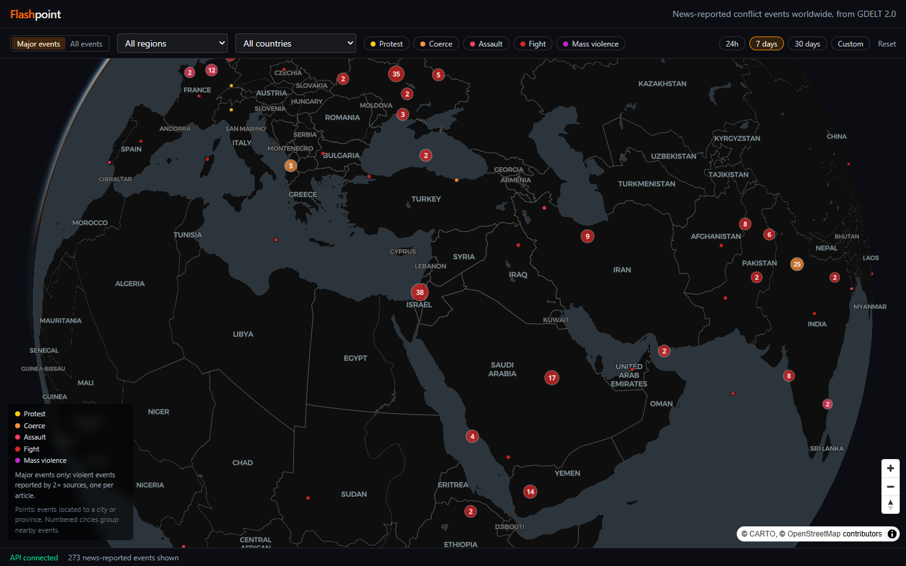

# Flashpoint

**A live 3D globe of news-reported conflict events worldwide, built from the GDELT 2.0 event feed.**

**[Open the live map →](https://flashpoint.infinitytrip013.workers.dev)** · [API docs](https://flashpoint-production-7f91.up.railway.app/docs)



Every 15 minutes, [GDELT](https://www.gdeltproject.org/) publishes a file of events that software has coded from news articles around the world: who did what to whom, where, and how many outlets reported it. Flashpoint ingests each file, keeps the conflict events (protests, coercion, assaults, fighting and mass violence), and serves them on a globe and through a public API.

## What it does

- **Opens on what matters.** The default view shows *major events* from the last 24 hours, about 60 a day instead of about 10,000. A major event is a violent one (assault, fighting, mass violence, violent protest or violent repression) that at least two news sources reported, shown once per source article.
- **Filters by region, country, conflict type and time.** Choose the last 24 hours, 7 days or 30 days, or a custom date range. Switch to *All events* for the full feed.
- **Every view is a link.** Filters and camera position live in the URL, so any view can be shared.
- **Zooms from the globe to the street.** Zoomed out, events merge into numbered clusters coloured by their most common type. Clicking zooms in. A detail card shows each event's actors, place, coverage, tone and source article.
- **Public REST API.** Grid counts, points, event detail and filter lists are available under `/v1/`, with OpenAPI docs.

## How it works

```
GDELT 2.0 export (every 15 min)
        │
        ▼
Ingest job (Railway cron) ──▶ PostgreSQL + PostGIS (Neon) ◀── FastAPI /v1/ (Railway)
                                                                    ▲
                                                                    │ JSON / GeoJSON
                                                     React + MapLibre globe (Cloudflare)
```

- **Ingest:**
  - Each run works out every 15-minute file between the newest one stored and GDELT's latest, then loads them in order, one transaction per file.
  - Rows are bulk-loaded with `COPY` into a staging table, then inserted while skipping event ids that already exist. Re-running a file is harmless, and missed runs catch up on their own.
  - Events older than 35 days are deleted on every run.
  - The initial backfill loaded 3,360 files with no failures.
- **Database:**
  - A normalized PostGIS schema: lookup tables for regions, countries, conflict types and CAMEO actions, plus one large, append-only `events` table.
  - The events table has a GiST spatial index and B-tree indexes for time, country and type.
- **API:**
  - Hand-written SQL through SQLAlchemy Core, with no ORM. Each endpoint has one named query in [`queries.py`](backend/src/flashpoint/queries.py).
  - Zoomed-out views are aggregated in the database with `ST_SnapToGrid`.
  - Point queries keep the most-reported events and use `DISTINCT ON` to show each source article once.
  - Bounding boxes that cross the 180° meridian are split in two.
- **Frontend:**
  - React 19 and TypeScript, with MapLibre GL's globe projection.
  - Clustering is done on the client by MapLibre.
  - TanStack Query caches responses and keeps the previous data on screen while new data loads.

[`ARCHITECTURE.md`](ARCHITECTURE.md) has the full design: schema, filters, endpoints and the planned surge method. [`GLOSSARY.md`](GLOSSARY.md) defines the terms used in this project.

## API

Base URL: `https://flashpoint-production-7f91.up.railway.app`

| Endpoint | Returns |
|---|---|
| `GET /v1/events/grid` | Event counts per grid cell for a zoom level and bounding box |
| `GET /v1/events` | City- and province-precision events as GeoJSON, most-reported first |
| `GET /v1/events/{id}` | One event with its type, action, place and actor countries resolved |
| `GET /v1/filters` | Regions, countries, conflict types and the stored date range |
| `GET /v1/health` | Database status and minutes since the last stored GDELT file |

The map endpoints share these filters: `region`, `country`, `type` (CAMEO root codes 14–20, repeatable), `window` (`24h`, `7d` or `30d`), `start`/`end`, and `scope` (`all` or `major`).

```sh
# Major events in the last 24 hours, worldwide
curl "https://flashpoint-production-7f91.up.railway.app/v1/events?scope=major&window=24h"

# Every fight or mass-violence event in Sudan over the last 7 days, counted on a grid
curl "https://flashpoint-production-7f91.up.railway.app/v1/events/grid?zoom=4&country=SU&type=19&type=20"
```

Country codes are GDELT's FIPS 10-4 codes, not ISO codes: `SU` is Sudan and `UK` is the United Kingdom. `/v1/filters` lists them all.

## Tech stack

| | |
|---|---|
| Backend | Python 3.13, FastAPI, Pydantic v2, SQLAlchemy Core, psycopg 3, Alembic (raw-SQL migrations), httpx |
| Database | PostgreSQL 17 + PostGIS 3.5 |
| Frontend | React 19, TypeScript, Vite, MapLibre GL JS, TanStack Query, Tailwind CSS |
| Tooling | uv, ruff, pytest, oxlint, Vitest, Docker Compose, GitHub Actions |
| Hosting | Neon (database), Railway (API and ingest cron), Cloudflare Workers (frontend) |

## Running locally

Requires Docker.

```sh
docker compose up          # PostGIS, the API on :8000 and the site on :5173
docker compose exec api flashpoint-ingest               # store the newest GDELT file
docker compose exec api flashpoint-ingest --backfill    # or load the full 35 days (about 3,400 files)
```

Then open http://localhost:5173. The API docs are at http://localhost:8000/docs.

## Tests

Backend tests feed synthetic GDELT export files through the real ingest job, served by a fake GDELT server. They then check the JSON that comes back from the HTTP API, against a real PostGIS database. Frontend tests cover the URL-state codec. CI runs both suites, plus linting, type checks and a production build, on every push.

```sh
docker compose up -d db
cd backend && uv run pytest
cd frontend && npm test
```

## Roadmap

- **Surging now:** countries whose last 7 days are statistically unusual compared with their own 21-day baseline, ranked by z-score
- **Replay:** step through the 35-day window day by day
- **API hardening:** rate limiting and cache headers
- About panel and mobile layout

## About the data

GDELT events are coded by software from news text, not checked by people. One real-world event often appears as several rows, and some rows are miscoded. For that reason, Flashpoint calls them *news-reported events*. It never presents them as confirmed incidents, and it never claims to remove duplicates or report casualty figures. The *major events* filter reduces this noise but cannot remove it.

Event data: [The GDELT Project](https://www.gdeltproject.org/). Basemap: © [CARTO](https://carto.com/attributions), © [OpenStreetMap](https://www.openstreetmap.org/copyright) contributors.
